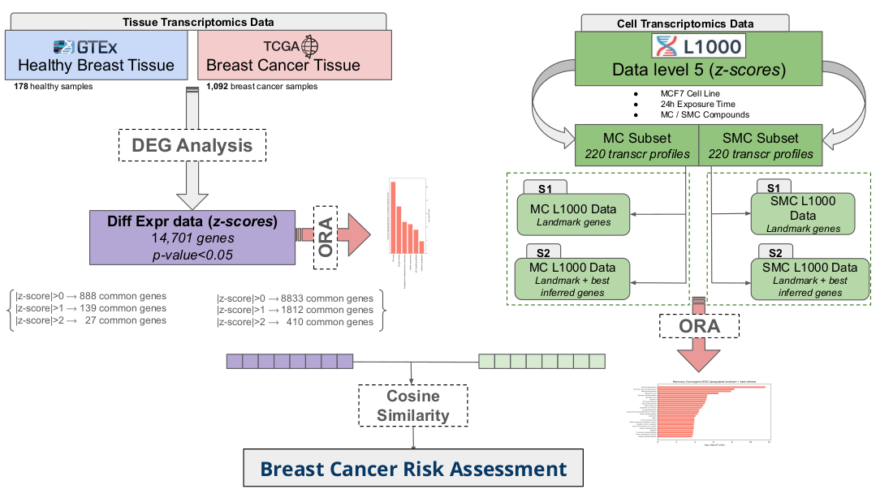

# Assessment of chemical risk factors for breast cancer from gene expression profiles



Code and results underlying our study on **ranking chemicals as candidate breast cancer
risk factors by comparing their transcriptional footprint in a breast cell line with the
deregulation observed in patient tumours**. The pipeline combines LINCS/CMap L1000
perturbation profiles in MCF7, differential expression between TCGA-BRCA tumours
(n = 1,092) and GTEx normal breast tissue, pathway enrichment, a cosine-similarity
scoring framework with an empirically calibrated threshold, and WGCNA co-expression
networks linking compounds to gene modules.

If you use this code or these results, please cite:

> Achebouche R., Taboureau O. *Assessment of chemical risk factor for breast cancer
> based on gene expression profiles.* Scientific Reports **15**, 43983 (2025).
> doi:[10.1038/s41598-025-27732-0](https://doi.org/10.1038/s41598-025-27732-0)

Throughout the code and the tables, **MC** denotes mammary carcinogens and **SMC**
suspected mammary carcinogens; **L** the 978 directly measured landmark genes and
**LBI** landmark + best-inferred genes. The SMC list is drawn from endocrine-disruptor
databases, which is why its input file is named `ED_merge.csv`.

The compound set is **161 compounds: 34 MC and 127 SMC**, those of the reference lists
that have an MCF7 signature at 24 h in LINCS — 220 and 840 signatures respectively, since
a compound is measured at several doses.

---

## Repository structure

```
.
├── data/
│   ├── README.md                 # what is versioned, what must be re-downloaded, licences
│   ├── chemicals/                # MC / SMC lists + frozen InChIKey -> name table
│   ├── lincs-metadata/           # LINCS 2020 compound & gene metadata, chemical<->pert_id maps
│   └── external/                 # inputs produced outside the repo (large ones not tracked)
├── analyses/
│   ├── common.py                 # shared functions: gene score, enrichment, null similarity
│   ├── 01_chemical_lists/        # build and merge the chemical reference lists
│   ├── 02_lincs_extraction/      # extract MCF7 L1000 signatures from the raw .gctx
│   ├── 03_lincs_ora/             # pathway enrichment of the compound signatures
│   ├── 04_tcga_gtex_dgea/        # TCGA-BRCA vs GTEx differential expression (R, edgeR)
│   ├── 05_cell_to_tissue/        # similarity threshold, then cell-to-tissue comparison
│   └── 06_wgcna_networks/        # co-expression modules and compound-gene networks
├── results/tables/               # the Supplementary Tables, as produced by the notebooks
│                                 #   + Supplementary_Tables.xlsx, the article's own
│                                 #     supplementary file, for reference
├── figures/                      # the figures of the published article
├── requirements.txt              # dependencies, versions open
├── requirements-verified.txt     # a pinned combination verified to run
├── LICENSE
└── README.md
```

## Pipeline / reproduction order

1. **`analyses/01_chemical_lists/data_concat.ipynb`** — assembles the MC and SMC
   reference lists on InChIKey and writes the combined compound table.
2. **`analyses/02_lincs_extraction/extract_L1000_l_bi.py`** — extracts, for each
   compound of the lists, the best-TAS MCF7 signature from the raw LINCS 2020 level-5
   `.gctx` matrix, for landmark and for landmark + best-inferred genes. Requires the raw
   `.gctx` (see *data/README.md*); its outputs are too large to be tracked.
3. **`analyses/03_lincs_ora/ORA.ipynb`** — KEGG and GO over-representation of the genes
   each class consistently deregulates → **Figures 1 and 2**, Tables S1-S10.
4. **`analyses/04_tcga_gtex_dgea/`** — the tissue side, in R:
   `DGEA_preprocess.Rmd` harmonises the TCGA-BRCA and GTEx matrices from UCSC Xena;
   `DGEA_analysis-edgeR.Rmd` runs the tumour vs normal test (quasi-likelihood F-test) and
   writes `DGEA_edgeR_QLF_all.csv`; `DGEA_analysis_indiv.Rmd` repeats it **per tumour**
   (1,092 fits); `tissue_enrichment_umap.ipynb` gives the tissue enrichment and the
   sample UMAP → **Figure 4**, **Supplementary Figure S1**, Tables S12-S13.
5. **`analyses/05_cell_to_tissue/01_similarity_threshold.ipynb`** — calibrates the
   similarity threshold. Because the cosine similarity of two unrelated profiles depends
   on how many genes are compared, the cut-off is set against a null distribution of
   random profiles, anchored on the lowest self-similarity observed between profiles of
   the same compound → **Figure 8**, **Supplementary Figure S2**, and the constant
   `k = 3.595` used next.
6. **`analyses/05_cell_to_tissue/02_cell_to_tissue_similarity.ipynb`** — the core
   analysis: each compound signature against the pooled tumour signature, against each
   of the 1,092 tumours, and MC against SMC → **Figures 3, 5 and 6**, Tables S11,
   S14-S16.
7. **`analyses/06_wgcna_networks/01_coexpression_modules.ipynb`** — PyWGCNA
   co-expression modules on the tumour matrix, and the thresholded edge list used for the
   network layout.
8. **`analyses/06_wgcna_networks/02_compound_gene_networks.ipynb`** — intersects each
   compound's deregulated genes with the two network clusters → **Supplementary
   Figure S3**, Tables S18-S26.

Steps 1-2 and 4 only need rerunning to regenerate the large intermediates. Steps 5-6 can
be run directly against the differential-expression table included in
`data/external/DGEA_TCGA_GTEX/`.

⚠️ **One step is manual.** The two network clusters (red-purple, green-grey) were
delimited visually in Cytoscape from the edge list of step 7. The resulting node
attributes are included as `results/tables/wgcna/TCGA_Network_0_13_full_table_attributes.csv`,
but that file cannot be regenerated by running the notebooks.

## Figure → code

| Figure | Produced by |
|---|---|
| Figure 1 — ORA of deregulated genes, MC (L1000) | `analyses/03_lincs_ora/ORA.ipynb` |
| Figure 2 — ORA of deregulated genes, SMC (L1000) | `analyses/03_lincs_ora/ORA.ipynb` |
| Figure 3 — MC / SMC cosine-similarity heatmap | `analyses/05_cell_to_tissue/02_cell_to_tissue_similarity.ipynb` |
| Figure 4 — KEGG enrichment, tumour vs normal tissue | `analyses/04_tcga_gtex_dgea/tissue_enrichment_umap.ipynb` |
| Figure 5 — similarity heatmap, TCGA samples vs L1000 MC | `analyses/05_cell_to_tissue/02_cell_to_tissue_similarity.ipynb` |
| Figure 6 — per-compound similarity, LBI genes | `analyses/05_cell_to_tissue/02_cell_to_tissue_similarity.ipynb` |
| Figure 7 — study workflow | schematic, no code |
| Figure 8 — self-similarity of three compounds | `analyses/05_cell_to_tissue/01_similarity_threshold.ipynb` |
| Supplementary S1 — UMAP of tissue samples | `analyses/04_tcga_gtex_dgea/tissue_enrichment_umap.ipynb` |
| Supplementary S2 — similarity threshold vs signature length | `analyses/05_cell_to_tissue/01_similarity_threshold.ipynb` |
| Supplementary S3 — MC / SMC compound–gene networks | `analyses/06_wgcna_networks/02_compound_gene_networks.ipynb` + Cytoscape |
| Supplementary S4 — WGCNA workflow | schematic, no code |

## Data availability

See **[`data/README.md`](data/README.md)** for the full inventory. In short: every light
input the notebooks read is included, including the tumour-vs-normal differential
expression table; the large matrices (raw LINCS `.gctx`, TCGA/GTEx expression matrices,
per-tumour differential expression, serialised PyWGCNA objects) are not tracked and are
either public at the source or regenerated by the scripts above.

All data used here are **open access**: LINCS/CMap 2020 (CLUE.io, GEO), TCGA-BRCA and
GTEx open-access expression and phenotype data (UCSC Xena), and public chemical lists
(IARC Monographs, DEDuCT, TEDX). No controlled-access TCGA or protected GTEx data are
used or redistributed.

## Environment

Python — for a reproducible install, use the pinned set the notebooks were verified on:

```bash
pip install -r requirements-verified.txt
```

`requirements.txt` lists the same packages without version constraints.

R (step 4): `edgeR`, `dplyr`, `UCSCXenaTools`, `data.table`, `R.utils` (Bioconductor/CRAN).

## Notes on re-running

- **The notebooks are committed with their outputs**, so the printed counts and a
  preview of each figure can be read without running anything. Inline previews are
  rendered at screen resolution while the saved files keep publication resolution
  (500 dpi): a figure is created without a `dpi` argument and `dpi=500` is passed to
  `savefig`. Where the preview cannot show the labels — Figures 3, 5 and 6 carry
  hundreds of compound labels at font size 2 — a comment names the file in `figures/`
  to open instead. Figure 8 is 75 x 25 inches and is not previewed at all, for the same
  reason. One notebook is committed without outputs:
  `06_wgcna_networks/01_coexpression_modules.ipynb`, whose module search takes hours on
  18,232 genes and whose module colour names are not stable across runs.
- **Compound names are a versioned table**, `data/chemicals/compound_names.csv`, rather
  than a live PubChem query: PubChem reorders its synonym lists over time, and axis
  labels that depend on a live database are not reproducible. PubChem is only queried
  for InChIKeys the table does not cover.
- **`figures/` holds the figures as published.** Re-running the notebooks overwrites them
  with regenerated versions, equivalent in content but not byte-identical: Figures 1 and
  2 were assembled from two separate two-panel figures, and Supplementary Figure S1 is a
  UMAP, which had no seed originally and now has one.
- **`gseapy.enrichr` changed signature between major versions.** The call in
  `analyses/common.py` is built from the signature actually available, so the notebooks
  run on either generation of the library.

## Limitations

Read this section before the results.

- **One cell line.** Compound signatures come from **MCF7** only — one ER-positive
  breast cancer line. Nothing here says how these compounds behave in other breast
  cell types, let alone in a tissue.
- **Transcriptional similarity is not causality.** A compound whose signature resembles
  tumour deregulation is a *candidate* risk factor, not a demonstrated carcinogen.
- **L1000 is a partial measurement**: 978 landmark genes plus inferred genes; the
  inferred part carries its own error, which is why landmark-only and
  landmark + best-inferred analyses are reported separately throughout.
- **The similarity threshold is empirical.** It is calibrated against random profiles
  and anchored on three reference compounds; it is a defensible convention, not a test
  with a controlled false-positive rate.
- **The per-tumour differential expression has no replication on the tumour side**: one
  tumour against the normal samples. Those statistics rank genes within a tumour; they
  are not calibrated p-values.
- **Doses and exposure times** in LINCS are pharmacological screening conditions, not
  environmental exposure scenarios.
- **No experimental validation**: the whole study is computational, on public data.
- **Reference-list bias**: the MC and SMC lists reflect the state of public annotation
  at the time of the query (October 2023), and absence from a list is not evidence of
  safety.

## License

MIT License — see [LICENSE](LICENSE).

## Authors

Rayane Achebouche, Olivier Taboureau — Université Paris Cité, CNRS, Unité de Biologie
Fonctionnelle et Adaptative, INSERM U1133, Paris, France.
